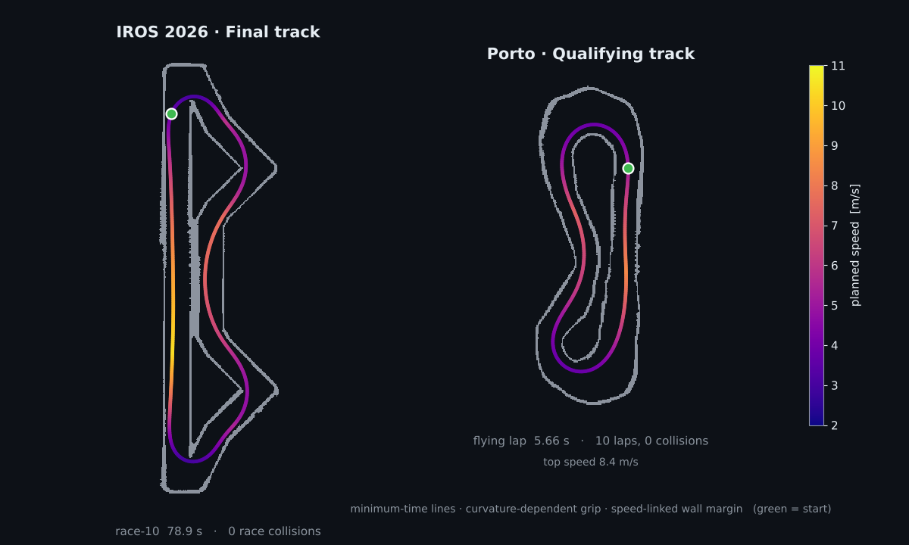

<div align="center">

# 🏎️ Roboracer (한국어)

**AutoDRIVE RoboRacer Sim Racing League 자율주행 레이싱 스택**

*LiDAR + IMU + 엔코더 위치추정 · 최소시간 레이싱라인 · 지연 보상 MPC · 예측형 트랙션 제어 · GT 없는 미지 트랙 매핑*



[English README](README.md) · [작업 노트 (NOTES.md)](NOTES.md) · [차량 물리 정리](docs/ref_abdullah_VEHICLE_MODEL.md)

</div>

---

## ✨ 핵심
- **허용 센서만 사용:** 대회 런타임에 GT(`/odom`, `/ips`, `/tf`)와 lap·collision 토픽을 쓰지 않습니다. 위치는 IMU yaw + 엔코더(타이어 관측기) + LiDAR 스캔 정합으로 구합니다.
- **물리 기반 계획:** 곡률에 따른 그립, 속도연동 벽 여유, 2.5cm 계획 맵으로 최소시간 라인을 풉니다. 파라미터는 모두 시뮬에서 실측한 값입니다.
- **지연 보상 MPC:** 명령 지연과 조향 서보를 모델에 넣은 선형 MPC입니다. OSQP로 약 1.5ms에 풀립니다.
- **예측형 트랙션 제어:** 스로틀은 약 0.165초 늦게 바퀴에 반영됩니다. 이미 보낸 명령으로 그 시점의 차속을 예측해서, 가속·제동 모두 타이어 최대 마찰 슬립을 유지합니다. 실측 랩을 재현하는 종방향 모델에서 랩당 0.16~0.44초 빨랐습니다.
- **대회 당일 명령 하나:** Docker 이미지 하나가 첫 LiDAR 스캔으로 트랙을 판별하고, 맞는 설정으로 노드를 띄우고, 죽으면 재기동합니다.
- **미지 트랙:** 탐색 주행 + 자체 SLAM으로 한 바퀴 매핑하고, 약 5초 만에 라인을 만들어 MPC로 넘깁니다. 최소시간 라인은 주행 중에 교체합니다.
- **대회 주간 플레이북:** 결승 트랙이 공개되면 명령 하나로 매핑부터 라인까지 끝납니다. 오프라인 리허설에서 수동 튜닝 라인과 0.02초 차이였습니다.
- **데이터 기반 튜닝:** 연습 주행 기록 → 시뮬 보정 → 구간별 속도 학습으로, 연습할 때마다 모델과 라인이 좋아집니다.

## 🏁 결과
모두 공식 시뮬 빌드에서, 자체 위치추정(GT 미사용)으로 달린 결과입니다.

| 트랙 | 설정 | 결과 | IROS 2026 공식 기록 |
|---|---|---|---|
| **IROS 2026 결승** | [`results/iros26_combo.json`](results/iros26_combo.json) | **레이스10 78.9초** (검증 3회: 78.90·78.87 충돌 0, 80.77 충돌 1) | 3위 73.97 · 4위 81.39 |
| **Porto 예선** | [`results/porto_mt_best.json`](results/porto_mt_best.json) | **플라잉 랩 5.66초**, 10랩 충돌 0, 4회 반복 | — |

IROS 단축 과정: 91.5초(Porto 설정 이식) → 85.2초(곡률연속 그립 최소시간 라인) → 79.9초(속도연동 여유·2.5cm 맵·MPC 가중치 속도 스케줄) → **78.9초**(최적 슬립 제동·조향 상한·충돌 복귀 안전장치)

## 🔬 남은 시간은 어디에
IROS 2026 라인의 오프라인 분석 결과입니다(상세는 [NOTES.md](NOTES.md)).
- **라인 모양은 이미 수렴했습니다.** 시작 라인 5개 × 평활 가중치 4개로 20번 다시 풀었는데 모두 7.65~7.68초였습니다. 현재 라인은 7.67초입니다.
- **가장 큰 레버는 가속입니다.** 계획 가속을 5.0으로 두고 계산하면 두 라인 모두 실측 랩과 일치합니다(7.89 ↔ 7.89, 7.98 ↔ 7.99). 즉 차가 계획(6.0)보다 약하게 가속하고 있습니다.
- **원인:** 스로틀은 바퀴 속도 지령이고 0.165초 늦게 반영됩니다. 그래서 현재 속도 기준으로 지령하면 슬립이 약 5%에 그치는데, 타이어 마찰은 슬립 약 15%에서 최대입니다.

| 1차원 종방향 시뮬([`tools/long_sim.py`](tools/long_sim.py), 실측 ±0.1초 재현) | 랩 | 그립 한계 시간 |
|---|---|---|
| 현재 (smode 2) | 7.80초 | 4.65% |
| 예측형 트랙션+제동 (`spred 2`, 슬립 0.10) | 7.63초 | 3.78% |
| C1: 가속 계획 7.0 + 예측 제어 0.10 | 7.56초 | 3.72% |
| **C2: 가속 계획 7.0 + 예측 제어 0.15** | **7.44초** | **4.39%** |
| C3: C2 + 라인 재최적화 | 7.36초 | 4.92% |

- 지연, 마찰, 측정 지연, 그립, 바퀴 이득을 틀리게 넣은 조건들에서도 이득이 유지됐습니다.
- 시뮬이 실측보다 0.09초 빠르므로, C2는 레이스10 약 75.3초, C3는 약 74.5초에 해당합니다.
- 후보 목록과 시험 순서는 [`results/iros_tc_cand.json`](results/iros_tc_cand.json)에 있습니다.

## 🏆 1위(7.16초/랩)까지

| 단계 | 랩 | 상태 |
|---|---|---|
| 현재 실측 | 7.89초 | ✅ |
| 예측형 트랙션 제어 + 가속 계획 7.0 (C2~C3) | 약 7.45~7.53초 | 코드 준비, PC 시험 필요 |
| 헤어핀 포함 모든 코너 약 1g | **7.16초** | 횡방향 보정 시뮬 필요 → **데이터** |

남은 약 0.3초는 코너링에서 나와야 합니다. 그러려면 실제 횡방향 반응과 맞는 시뮬이 필요하고, 보정 루프는 준비돼 있습니다.
1. **PC에서 기록:** `bash tools/sysid_run.sh` (약 10분). 현재 설정 11랩, 그립 한계 스윕, C2를 주행하며 명령·실제 액추에이터·GT·IMU·엔코더를 기록합니다.
2. **보정:** `python3 tools/adsim_fit.py data/sysid_*.npz fit.json`. 조향 서보, 스로틀 지연, 타이어 마찰, 언더스티어, 요 지연, 그립 한계를 피팅합니다. 18Hz에서 프레임 내 지연은 요레이트·차속과 함께 맞춰 식별합니다(`race/test_adsim_fit.py`로 검증).
3. **오프라인 개발:** 보정 시뮬(`tools/adsim.py --sim_file fit.json`)에서 코너링 제어(슬립 고려 MPC, 코너별 그립)를 개발·검증한 뒤 PC 시험으로 넘깁니다.

## 🚀 시작하기
```bash
# Ubuntu 22.04 + ROS 2 Humble
git clone https://github.com/eungyun-im/Roboracer.git && cd Roboracer
./setup.sh --sims        # venv, 파이썬 의존성, devkit 빌드, 시뮬 다운로드 (누락 apt 패키지는 안내대로 설치 후 재실행)
source env.sh            # 매 터미널

ros2 launch autodrive_roboracer bringup_headless.launch.py    # 1. 브리지
bash tools/sim_up.sh sim/c_2026-iros/autodrive_simulator      # 2. 시뮬 (연결 버튼 자동 클릭, 화면 사용 중엔 쓰지 말 것)
bash tools/run_combo_iros.sh                                  # 3. 워밍업1 + 레이스10, 현재 최고 설정
```
- 데이터 확인: `python3 tools/rate.py` (약 18Hz)
- 브리지가 멈추면(0Hz, 포트 4567 점유): 브리지 프로세스를 `kill -9`하고 1번을 다시 실행합니다. 시뮬은 자동 재연결됩니다.

**후보 시험**
```bash
bash tools/run_tc_iros.sh 11 0.10 1.0 2 maps/iros_cand/iros26_tc_a7.csv        # C1
bash tools/run_tc_iros.sh 11 0.15 1.0 2 maps/iros_cand/iros26_tc_a7.csv        # C2
bash tools/run_tc_iros.sh 11 0.15 1.0 2 maps/iros_cand/iros26_tc_a7_reopt.csv  # C3
bash tools/run_porto.sh maps/porto_cand/porto_m025_z040.csv 11                 # Porto 후보 (results/porto_cand.json)
```
각 후보에서 11랩 충돌 0회를 2번 통과하면 다음 후보로 넘어가세요.

## 🐳 대회 제출
```bash
docker build -f race/Dockerfile -t <TEAM>/<IMAGE>:<TAG> .   # 베이스: autodrive_roboracer_api:2026-iros-compete (브리지 무수정)
bash race/run_local.sh [auto|porto|iros26|explore]          # 도커 없이 같은 방식으로 실행 → 시뮬에서 연결
bash race/audit_topics.sh                                   # (실행 중 다른 터미널) 금지 토픽 사용 여부 점검
```
- 엔트리포인트 [`race/autodrive_devkit.sh`](race/autodrive_devkit.sh)는 공식 브리지와 [`race/race_launch.py`](race/race_launch.py)를 함께 띄웁니다. 컨테이너를 `--entrypoint /bin/bash`로 띄웠다면 `/home/autodrive_devkit.sh`를 직접 실행하면 됩니다.
- `race_launch.py`가 하는 일:
  - 첫 스캔을 각 트랙 맵의 출발점에서 레이캐스팅한 예상 거리와 비교해 트랙을 판별합니다([`race/tracks.json`](race/tracks.json)). `TRACK=`으로 강제할 수 있습니다.
  - 대회 모드로 위치추정과 주행 노드를 띄우고, 죽으면 재기동합니다.
  - 모르는 트랙이면 explore 흐름으로 넘어갑니다.
- MPC 명령 지연은 측정 주기가 18Hz에서 15% 이상 벗어날 때만 비례 조정합니다.

## 📅 대회 주간 플레이북
지난 대회들에서 결승 트랙은 **결승 2~5일 전**에 공개됐습니다(ICRA 2025: 2~3일, CDC 2025: 4~5일).

| 날짜 | 명령 | 내용 |
|---|---|---|
| **D-3** (트랙 공개) | `bash tools/new_track.sh <이름>` | 매핑 주행(연습 단계라 GT 허용) → 5cm·2.5cm 맵 → 중심선 → 최소시간 라인 → 라인 검증 → `tracks.json` 등록 → 트랙 판별 확인 |
| **D-2** | `bash tools/run_track.sh <이름>` · `bash tools/ilc_iter.sh <이름> 4` · `bash tools/run_track.sh <이름> '' 11 --smode 3 --spred 2 --sacc 0.10 --scap 1.0` | 11랩 검증, 구간별 속도 학습, 트랙션 제어 |
| **D-1** | `bash race/preflight.sh <TEAM>/<IMAGE>:<TAG>` | 모든 트랙 오프라인 시험 + Docker 빌드 → 제출 |

- **리허설:** `race/test_new_track.py`로 IROS26 맵에서 돌렸습니다. 파이프라인이 약 8초 걸리고 예상 랩 7.69초가 나왔습니다(수동 튜닝 7.67초).
- **벽 편향 제거:** 이 수준까지 오려면 맵의 벽 편향을 없애야 했습니다. LiDAR 노이즈로 벽이 약 3cm 두껍게 그려졌는데, `build_track.py`의 `OCC_FRAC`로 해결했습니다(편향 -2.8 → -0.3cm).

## 🧪 오프라인 시험 (ROS·시뮬 없이)
푸쉬할 때마다 [GitHub Actions](.github/workflows/offline-tests.yml)에서도 자동으로 돕니다. ROS는 스텁으로 대체하고, 센서는 실제 맵을 레이캐스팅해 합성합니다.

| 시험 | 확인 내용 |
|---|---|
| `race/test_comp_topics.py` | 대회 모드 노드가 금지 토픽을 쓰지 않음 |
| `race/test_identify.py` | 등록된 트랙을 첫 스캔으로 판별, 모르는 트랙은 explore |
| `race/test_localizer_offline.py [트랙]` | 출발점·랩 중간 인계에서 위치추정 |
| `race/test_explore_offline.py [map center]` | 탐색 → SLAM → 라인 생성 → 정답 중심선과 비교 |
| `race/test_lines.py [line.csv …]` | 배포·후보 라인 주행 가능성(벽 거리, 조향각·조향 속도, 횡·제동 한계) |
| `race/test_long_sim.py` | 종방향 모델이 실측 재현, 트랙션 제어가 더 빠르고 위험 증가 없음 |
| `race/test_new_track.py` | D-3 플레이북 리허설 |
| `race/test_adsim_fit.py` | 시뮬 보정 도구가 알려진 파라미터를 되찾고 폐루프 결과를 재현 |

## 📂 구조
```
race/            제출 패키지: Dockerfile, 엔트리포인트, 실행기, 트랙 설정, preflight, 시험
tools/
  localizer.py   racer.py   racer_core.py       런타임: 위치추정, MPC, 트랙션 제어, 안전층
  raceline.py    mintime.py profile_region.py   계획: 최소곡률, 최소시간, 속도 프로파일
  slam_lite.py   explore.py auto_track.py       미지 트랙 매핑·라인 생성
  build_track.py                                매핑 기록 → 점유맵 + 중심선
  new_track.sh   track_add.py run_track.sh      대회 주간 플레이북: 아무 트랙 매핑·등록·시험
  ilc_profile.py ilc_iter.sh                    연습 주행 로그로 구간별 속도 학습
  sysid_run.sh   adsim_fit.py                   연습 데이터 기록, 시뮬 보정
  adsim.py long_sim.py gymsim.py scan_sim.py    오프라인 시뮬·가상 센서
  run_combo_iros.sh run_tc_iros.sh run_porto.sh 현재 최고·후보 시험 주행
maps/            점유맵, 중심선, 라인 (iros_cand/, porto_cand/ = 실주행 검증 전 후보)
results/         최적 설정과 검증 결과, 후보 요약
docs/            시뮬 소스 기반 차량 물리, 그림
src/autodrive_devkit/   공식 devkit 브리지 (대회 규칙상 수정 금지)
```
`data/`, `bags/`, `downloads/`(매핑 원자료·bag)는 용량 때문에 레포에 없습니다. 필요하면 원본 PC에서 복사하거나 `git add -f`로 올리세요.

## ⚖️ 규칙 준수
- **금지 토픽:** 대회 모드(`--comp 1`)는 금지 토픽(`/odom`, `/ips`, `/tf`, `lap_*`, `collision_count`)을 구독하지 않고 `reset_command`도 보내지 않습니다. `race/test_comp_topics.py`가 실행기가 넘기는 인자 그대로 이를 검사합니다.
- **자동 실행 없음:** `~/.bashrc` 자동 실행이 없고, 공식 브리지와 시뮬도 수정하지 않습니다.
- **분석 전용 도구:** GT 확인과 랩 집계는 시험 스크립트 안에만 있는 분석용 기능입니다.

## 🗺️ 진행 상황

| 항목 | 상태 |
|---|---|
| 대회 Docker 이미지 | 작성 완료, PC에서 빌드·실행 확인 필요 (`race/preflight.sh`) |
| 대회 주간 플레이북 | 오프라인 리허설 통과(수동 대비 0.02초), PC 예행연습 필요 |
| 미지 트랙(explore) | 합성 데이터 시험 통과, 실제 시뮬 확인 필요(ICRA26 포함) |
| 예측형 트랙션 제어 + 가속 계획 상향 (C1~C3) | 종방향 모델 예측 랩당 -0.24~-0.44초, PC 시험 필요 |
| Porto 후보 (예상 5.18~5.28초, 현재 5.35초) | 오프라인 계산, PC 시험 필요 |
| 구간별 속도 학습 (`ilc_iter.sh`) | 동작 확인, 연습 주행 필요 |
| LiDAR 안전층 (`--guard 1`) | 실험적, 기본 꺼짐 |
| 오프라인 시뮬 보정 (`adsim_fit.py`) | 도구 검증 완료, **`sysid_run.sh` 데이터 대기 — 1위로 가는 다음 단계** |
