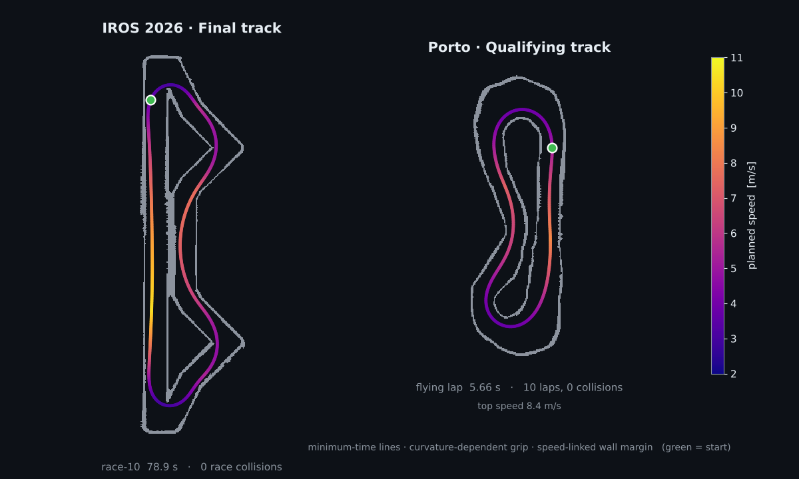
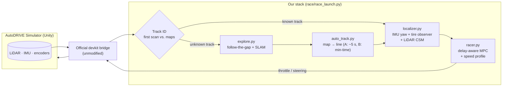
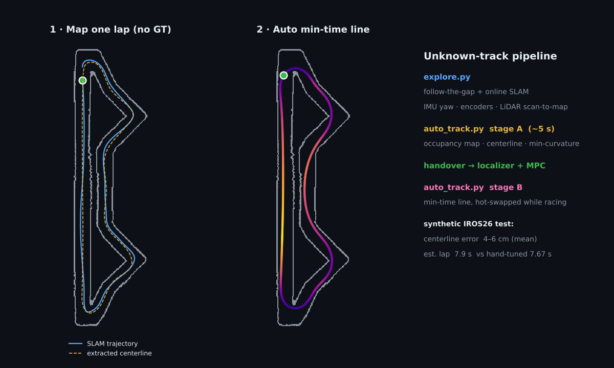

<div align="center">

# 🏎️ Roboracer

**An autonomous racing stack for the AutoDRIVE RoboRacer Sim Racing League**

*LiDAR + IMU + wheel-encoder localization · minimum-time racing lines · delay-aware MPC · GT-free mapping of unseen tracks*

[](https://docs.ros.org/en/humble/)
[](https://www.python.org/)
[](race/Dockerfile)
[](#-how-it-works)
[](https://github.com/eungyun-im/Roboracer/actions/workflows/offline-tests.yml)
[](#-rules-compliance)



[한국어 README](README.ko.md) · [Engineering log (NOTES.md)](NOTES.md) · [Vehicle physics notes](docs/ref_abdullah_VEHICLE_MODEL.md)

</div>

---

## ✨ Highlights

- **Runs on allowed sensors only.** At race time the stack never reads the simulator's ground truth (`/odom`, `/ips`, `/tf`) or the lap and collision topics. Position comes from IMU yaw, wheel encoders (through a tire-slip observer) and LiDAR scan matching.
- **Physics-aware planning.** Racing lines are solved as minimum-time problems with grip that depends on curvature, a wall margin that grows with speed, and a 2.5 cm planning map. The parameters come from measurements in the simulator.
- **Delay-aware MPC.** A linear MPC in Frenet coordinates models the command delay and the steering servo. It solves in about 1.5 ms with OSQP (horizon 15) and feeds forward the planned acceleration. Braking holds the tire near its peak slip.
- **One command for race day.** A single Docker image identifies the track from the first LiDAR scan, starts the right configuration and restarts any node that crashes.
- **Unseen tracks.** If the track is unknown, the car drives a follow-the-gap lap while building a map with its own SLAM (no ground truth). It then generates a racing line in about 5 seconds, hands control to the MPC, and swaps in a minimum-time line once that is ready.

## 🏁 Results

All runs below are in the official simulator builds, with the car localizing itself (no ground truth used).

| Track | Configuration | Result | Official IROS 2026 reference |
|---|---|---|---|
| **IROS 2026 final** | [`results/iros26_combo.json`](results/iros26_combo.json) | **race-10 78.9 s** — 3 validation runs: 78.90 and 78.87 with 0 race collisions, 80.77 with 1 | 3rd place 73.97 s · 4th place 81.39 s |
| **Porto qualifying** | [`results/porto_mt_best.json`](results/porto_mt_best.json) | **5.66 s flying lap**, 10 laps, 0 collisions, repeated 4× (≈ 56.6 s over 10 flying laps) | — |

**How the IROS time came down**

| Step | Race-10 |
|---|---|
| First transfer of the Porto settings | 91.5 s |
| Minimum-time line with curvature-dependent grip | 85.2 s |
| Speed-linked wall margin, 2.5 cm planning map, speed-scheduled MPC weights | 79.9 s |
| Optimal-slip braking, steering cap based on front-tire slip angle, collision-recovery safeguards | **78.9 s** |

Every step is documented in [NOTES.md](NOTES.md) (in Korean).

## 🧭 How it works



<details>
<summary><b>Localization</b> — <code>tools/localizer.py</code></summary>

- Heading comes straight from the IMU yaw, which is noise-free in the simulator. Speed comes from a tire observer: the encoders measure the wheel's surface speed, not the car's speed.
- The dead-reckoned pose is corrected every scan by correlative scan matching on a precomputed distance field (search window ±0.25 m, 2.5 cm steps).
- After a collision the simulator respawns the car at a checkpoint. The localizer detects this as a heading jump the gyro cannot explain, then re-initializes within 2 m and limits speed for 3 s while recovering.
- Offline error: about 1.8 cm lateral and 5.9 cm longitudinal.
</details>

<details>
<summary><b>Planning</b> — <code>tools/raceline.py</code>, <code>tools/mintime.py</code>, <code>tools/profile_region.py</code></summary>

- **Reference line:** minimum curvature via OSQP, then an elastic-band refinement that keeps the wall margin directly on the distance field.
- **Minimum-time line** (CasADi/IPOPT) optimizes the lateral offset and the speed together, subject to:
  - a friction ellipse whose lateral grip is `alat(κ) = max(6.5, 9.2 − 2.5·(κ − 0.6)₊)`, measured with corner speed sweeps;
  - a wall margin `0.175 m + 0.015 m per m/s` above 4 m/s;
  - a curvature limit.
- **Speed profile** includes linear aerodynamic drag (0.273·v) and per-region grip multipliers.
</details>

<details>
<summary><b>Control</b> — <code>tools/racer_core.py</code></summary>

- **Model:** linear MPC on the Frenet states `[e_y, e_ψ]`, linearized around the path's steering angle and including understeer.
- **Delay compensation:** the commands already sent are replayed through a rate-limited servo model before the horizon starts, so the MPC plans from where the car will actually be.
- **Weights:** the lateral-error weight is scheduled with speed, which reduces deviation at high speed without hurting the hairpins.
- **Speed:** a feed-forward on the planned acceleration (it does not depend on the noisy speed estimate). Braking holds the wheel speed near the tire's peak slip.
- **Steering cap:** steering is limited to the angle the path curvature needs plus a 2° allowance for front-tire slip.
- **Frame-rate adaptation:** the command delay is scaled with the measured loop rate when it differs from 18 Hz.
</details>

<details>
<summary><b>Unseen tracks</b> — <code>tools/slam_lite.py</code>, <code>tools/explore.py</code>, <code>tools/auto_track.py</code></summary>



- **SLAM:** because the yaw is exact, the SLAM only estimates position. It matches each scan against a likelihood grid built so far, and a motion prior stops the pose from sliding along long straight corridors.
- **Loop closure:** applied only when the match is sharp and unambiguous.
- **Centerline:** extracted by repeatedly moving the driven trajectory toward the middle of the track. Unlike skeletonization, this handles open walls and side branches.
- **Line generation** repeats the hand-tuned IROS procedure automatically. Stage A has a line ready in about 5 s; stage B's minimum-time line replaces it while the car is racing.
</details>

## 🚀 Quick start

```bash
# Ubuntu 22.04 + ROS 2 Humble
git clone https://github.com/eungyun-im/Roboracer.git && cd Roboracer
./setup.sh --sims        # venv, Python deps, devkit build, simulator downloads
source env.sh            # in every terminal

ros2 launch autodrive_roboracer bringup_headless.launch.py               # 1. bridge
bash tools/sim_up.sh sim/c_2026-iros/autodrive_simulator                 # 2. simulator (auto-clicks "connect")
bash tools/run_combo_iros.sh                                             # 3. warm-up + 10 race laps, best config
```

## 🐳 Competition submission

```bash
docker build -f race/Dockerfile -t <TEAM>/<IMAGE>:<TAG> .   # based on autodrive_roboracer_api:2026-iros-compete
bash race/run_local.sh [auto|porto|iros26|explore]          # same entrypoint without Docker
bash race/audit_topics.sh                                   # while running: verify no restricted topics are used
```

The entrypoint [`race/autodrive_devkit.sh`](race/autodrive_devkit.sh) starts the **unmodified** official bridge together with [`race/race_launch.py`](race/race_launch.py), which:

1. waits for the first LiDAR scan and IMU message;
2. compares the scan with ray-cast predictions from each known map's start pose ([`race/tracks.json`](race/tracks.json));
3. starts the localizer and the MPC in competition mode, or falls back to the unseen-track flow;
4. restarts crashed nodes, and resumes the same track decision if it is restarted itself.

## 🧪 Offline tests (no ROS, no simulator)

These also run on every push in [GitHub Actions](.github/workflows/offline-tests.yml).

ROS is replaced with a small stub, and LiDAR, encoder and IMU data are synthesized by ray casting the real maps.

| Test | Checks |
|---|---|
| `python3 race/test_comp_topics.py` | Competition-mode nodes subscribe and publish no restricted topics |
| `python3 race/test_identify.py` | Porto and IROS26 are identified from the first scan; an unknown track falls back to `explore` |
| `python3 race/test_localizer_offline.py [iros26\|porto]` | Localization from the start pose, and from a mid-lap handover pose |
| `python3 race/test_explore_offline.py [map center]` | Exploration → SLAM → stage A + B → centerline compared with ground truth |
| `python3 race/test_lines.py [line.csv …]` | Deployed and candidate lines are drivable: wall clearance, steering angle, steering rate, lateral and braking limits |
| `python3 race/test_long_sim.py` | Longitudinal model reproduces real laps; traction control is faster without more time at the grip limit |

## 📂 Repository layout

```
race/            competition package: Dockerfile, entrypoint, launcher, track config, tests
tools/
  localizer.py   racer.py   racer_core.py      runtime: localization, MPC/pure pursuit, guard
  raceline.py    mintime.py profile_region.py  planning: min-curvature, min-time, speed profiles
  slam_lite.py   explore.py auto_track.py      unseen-track mapping and line generation
  build_track.py                               occupancy map + centerline from a mapping record
  ilc_profile.py ilc_iter.sh                   per-segment speed tuning from practice-run logs
  adsim.py gymsim.py scan_sim.py               offline simulators and synthetic sensors
maps/            occupancy maps, centerlines, racing lines (porto_cand/ = untested Porto candidates)
results/         best configurations with validation runs
docs/            vehicle physics derived from the simulator source, figures
src/autodrive_devkit/   official devkit bridge (unmodified, per competition rules)
```

## ⚖️ Rules compliance

- **Restricted topics.** In competition mode (`--comp 1`) the nodes never touch the restricted topics (`/odom`, `/ips`, `/tf`, `lap_*`, `collision_count`) and never publish `reset_command`. `race/test_comp_topics.py` verifies this using the exact arguments the launcher passes.
- **No auto-start.** Nothing is started from `~/.bashrc`; the official bridge and simulator are not modified.
- **Analysis-only tools.** Ground-truth checks and lap counting exist only in the test scripts, for analysis.

## 🔬 Where the remaining time is

Offline analysis of the IROS 2026 line (details in [NOTES.md](NOTES.md)):

- **The line itself has converged.** Twenty minimum-time solves were run with drag included, starting from five different reference lines with four smoothing weights. All of them land at 7.65–7.68 s, against 7.67 s for the deployed line.
- **Acceleration is the biggest lever.** Recomputing the planned profile with an acceleration limit of 5.0 m/s² instead of 6.0 reproduces the real laps on two independent lines: 7.89 s predicted vs 7.89 s real, and 7.98 s vs 7.99 s. So the car accelerates more weakly than planned.
- **Why.** The throttle commands a wheel speed, and the command reaches the wheel about 0.165 s later. A command based on the current speed therefore produces only about 5 % slip, while the tire's friction peaks at about 15 %.

| Change (lap time from the planned profile) | Δ per lap |
|---|---|
| acceleration 6.0 → 7.0 m/s² | −0.15 s |
| global grip 9.2 → 9.6 m/s² | −0.11 s |
| braking 8.5 → 9.5 m/s² | −0.03 s |
| +5 % grip in a single hairpin | −0.03 s |

**Predictive traction control (`--smode 3 --spred 2`).** The wheel speed for the next 0.165 s is already fixed by commands that were sent but have not taken effect yet. The controller therefore integrates those commands through the tire-slip model to predict the car's speed at the moment the new command takes effect. It then commands the wheel speed that gives the target slip at that moment: about 10 % when accelerating, and the optimal slip when braking. This is the same idea as the MPC's steering-delay compensation.

| 1-D longitudinal sim ([`tools/long_sim.py`](tools/long_sim.py), reproduces real laps within 0.1 s) | lap | time at grip limit |
|---|---|---|
| current (`smode 2`) | 7.80 s | 4.65 % |
| simple traction control (current speed + 6 m/s² × delay) | 7.72 s | 4.64 % |
| **predictive traction + braking** (`spred 2`, slip 0.10) | **7.63 s** | **3.78 %** |

The predictive version was also run with the delay, friction, measurement lag, speed noise, lateral grip and wheel gain each set wrong (10 conditions). In every one it was 0.16–0.20 s faster per lap than the current controller and spent less time at the grip limit. Try it on the race PC with `bash tools/run_tc_iros.sh`.

## 🗺️ Status and roadmap

| Item | Status |
|---|---|
| Competition Docker image | written; needs a build-and-run check on the race PC |
| Unseen-track pipeline | passes offline tests on synthetic data; needs a real-simulator run (including ICRA26) |
| Porto line candidates (est. 5.18–5.28 s vs 5.35 s) | computed offline; needs track testing (`tools/run_porto.sh`) |
| Per-segment speed tuning (`tools/ilc_iter.sh`) | mechanics verified offline; needs practice runs |
| Predictive traction control (`--smode 3 --spred 2`, `tools/run_tc_iros.sh`) | −0.16 to −0.20 s/lap predicted by the 1-D longitudinal model; needs track testing |
| LiDAR guard (`racer --guard 1`) | experimental, off by default |
| Offline physics simulator (`tools/adsim.py`) | **not calibrated** yet; needs recorded bags to calibrate |

---

<div align="center">
<sub>Built for the <a href="https://autodrive-ecosystem.github.io">AutoDRIVE</a> RoboRacer Sim Racing League. The simulator, the devkit and the RoboRacer platform belong to their respective owners.</sub>
</div>
